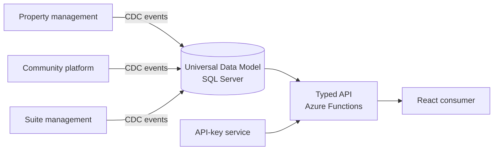
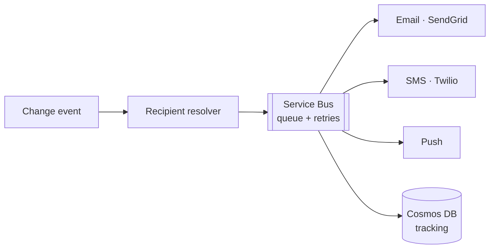

## Hi, I'm Iván Padrón 👋

**Senior backend engineer, 8+ years in C#, .NET, SQL Server and Azure. Specialized in APIs, integrations and event-driven systems.**

📍 Dominican Republic · Remote · English (advanced) · Spanish (native)
🌐 [Portfolio](https://dustman001.github.io) · 💼 [LinkedIn](https://www.linkedin.com/in/ivan-amado-padron-perez-39474574) · ✉️ dustman01@gmail.com

---

### What I build

I connect systems that were never designed to talk to each other: canonical data models, typed APIs, change-data-capture pipelines and resilient messaging on Azure, from the SQL schema all the way to production.

### Highlights

**Universal Data Model.** I designed the canonical SQL Server model that unifies three platforms (property management, community and suite management) for **30+ management companies and ~500 US communities**. It is fed by CDC events and exposed through typed Azure Functions endpoints.

**CDC event system.** A timer-triggered Azure Functions listener reads SQL Server CDC tables in every client database and publishes "entity changed" events to Event Hub. LSN checkpoints stop duplicate processing, batch sizes are configurable, and Kubernetes health probes restart a stuck listener.

**Notification service.** It resolves recipients by community, role and subscription rules. Messages are queued on Azure Service Bus and delivered by email (SendGrid), SMS (Twilio) and push, with Polly v8 for resilience and Cosmos DB for tracking.

**Also shipped:** bidirectional sync pipelines (ADF + Functions), an access-control and license-plate-recognition system, a community web platform taken to GA, payroll modernization from batch to event-driven sync, and utility KPI apps that cut human errors by 80%.

### Toolbox

- **Backend:** ASP.NET Core Web API, EF Core, Dapper, Polly, REST, SOAP, webhooks
- **Azure:** Functions, Service Bus, Event Hub, Data Factory, Key Vault, Application Insights, Azure DevOps
- **Data:** SQL Server, CDC, Cosmos DB, PostgreSQL, Redis
- **Architecture:** event-driven, microservices, serverless, CQRS, DDD, TDD
- **AI tooling:** Claude Code, RAG, MCP
